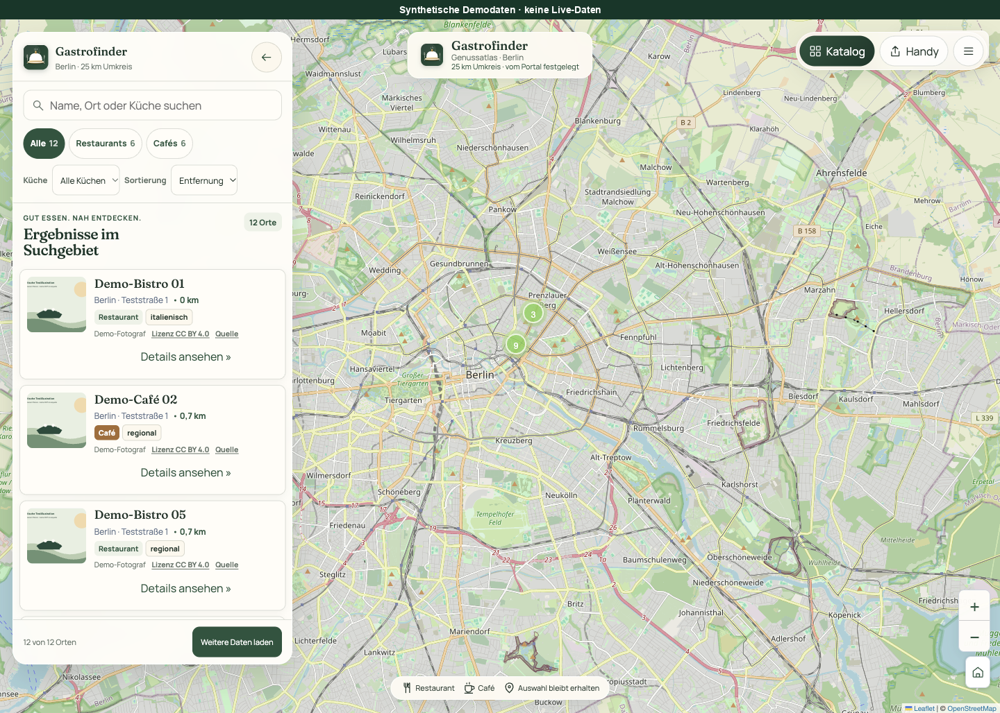
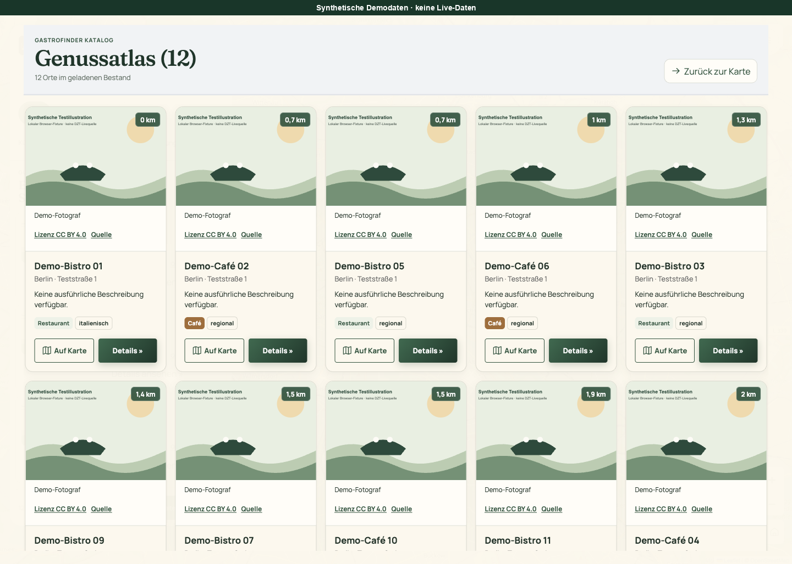
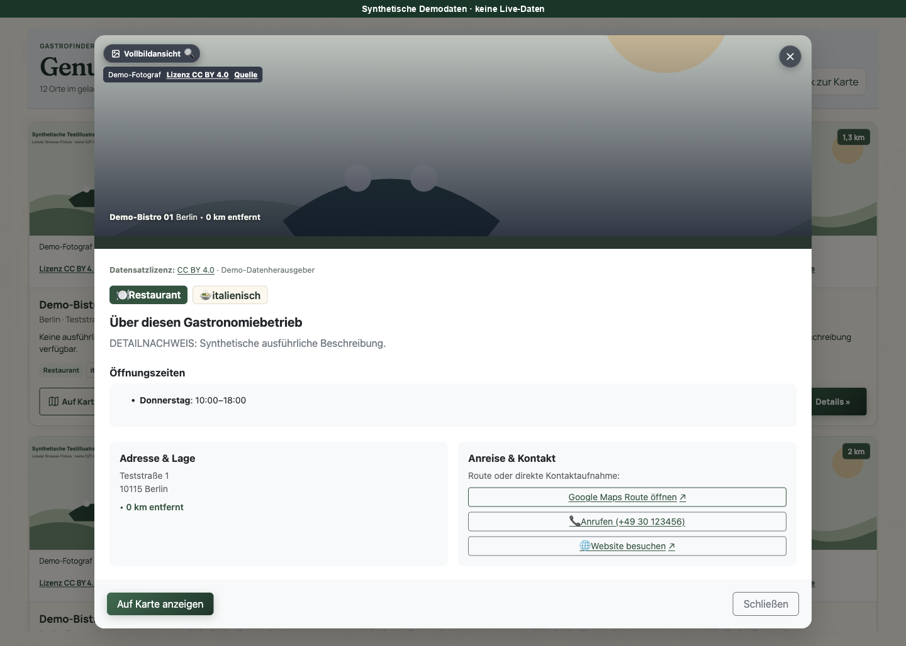
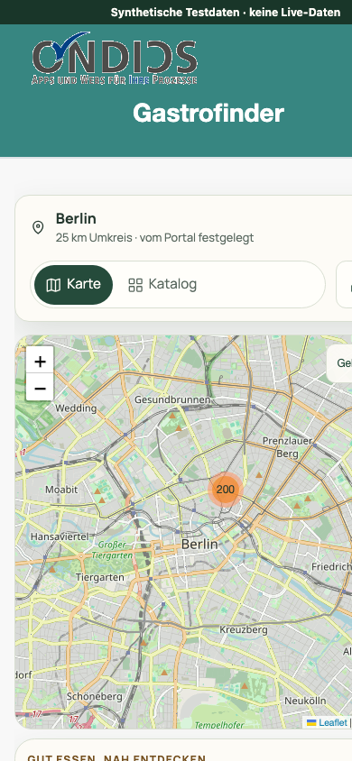
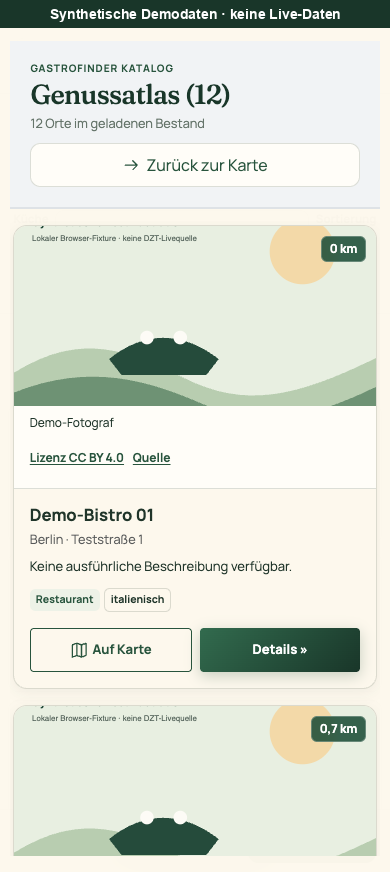
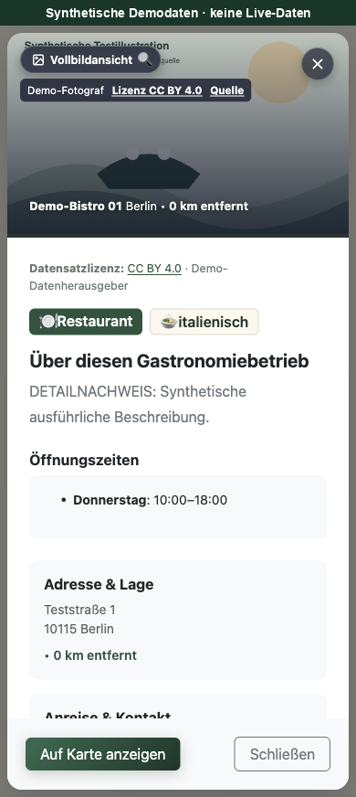

# Gastrofinder – Genussatlas

Der **Gastrofinder** erschließt Restaurants und Cafés aus dem DZT Knowledge Graph für kommunale und regionale Portale. Karte, Ergebnisliste, Katalog und Detailansicht beziehen sich auf ein vom Portalbetreiber festgelegtes Suchgebiet.

Die App ist für den [Open Data App Store](https://open-data-app-store.de/) und dessen [Open-Data-App-Spezifikation](https://open-data-apps.github.io/open-data-app-docs/open-data-app-spezifikation/) gemacht. Weitere Apps: [open-data-apps auf GitHub](https://github.com/open-data-apps).

## Für wen ist diese App?

Bürgerinnen, Bürger und Gäste können ohne besondere Datenkenntnisse nach Name, Ort, Küche und Betriebstyp suchen. Der Portalbetreiber konfiguriert Ort und Umkreis; die Besucheransicht bietet keine freie Deutschland- oder GPS-Suche.

## Funktionen

- Fullscreen-Karte mit Leaflet, Marker-Clustering, Vorschaupopups und Kartensteuerung.
- Einklappbares Cockpit mit Textsuche, Restaurant-/Café- und Küchenfiltern sowie Sortierung.
- Katalog und mobile Umschaltung zwischen Karte und Ergebnisliste.
- Detaildialog mit separat nachgeladenen Beschreibungen, Öffnungszeiten, Kontakten und Bildern.
- Bildgalerie mit Tastaturbedienung; getrennte Datensatz- und Bildnachweise.
- JSON-LD-Ansicht der verwendeten Quelldaten und Kopierfunktion mit Fehlerrückmeldung.
- QR-Code für die App-Adresse und Seiten für Beschreibung, Kontakt, Datenschutz und Impressum.

Öffnungszeiten sind Quellenangaben, keine Live-Ampel „jetzt geöffnet“. Eine fehlgeschlagene Detailabfrage ist von fehlenden Angaben unterscheidbar.

## Datenquelle und Grenzen

Die Abfrage verwendet ausschließlich die exakten Typen `https://schema.org/Restaurant` und `https://schema.org/CafeOrCoffeeShop`. Der Bestand wird nicht anhand von Namensstichwörtern ermittelt.

Die Übersicht lädt höchstens **200 eindeutige Quell-IDs je Seite**. Weitere Seiten werden ausdrücklich nachgeladen. Filter und Zähler beschreiben den geladenen Bestand, nicht sämtliche Gastronomiebetriebe der Region. `assets/schema.json` dokumentiert das normalisierte Darstellungsmodell; die JSON-LD-Ansicht enthält die verwendeten RDF-Tripel und verknüpften Knoten.

Datensatz- und Bildrechte werden getrennt geprüft. Ein Foto ohne eigenen ausreichenden Nachweis wird nicht angezeigt; eine Datensatzlizenz ist keine automatische Bildlizenz. Unterschiedliche Quellen können unterschiedliche Lizenzen und Einschränkungen haben.

### DZT-Relay

```text
GET <App-Basispfad>/dzt?path=ts/v1/kg/sparql?query=...
```

Die Runtime kontaktiert den DZT-API-Host **nicht direkt** und verwendet nicht `/odp-data`. Der Store setzt den DZT-Schlüssel serverseitig. In App-Code, lokaler Config und Liefer-ZIP gehört kein Schlüssel.

## Konfiguration

| Schlüssel | Bedeutung |
|---|---|
| `ort` | Betreiber-Ort; Paketstandard leer. |
| `radiusKm` | `5`, `10`, `25`, `50` oder `100` als String; Standard `25`. |
| `latitude` / `longitude` | Optionales vollständiges Koordinatenpaar; hat Vorrang vor der Ortsauflösung. |
| `apiurls` → `dztsparql` | Benannte Ressource mit dem kanonischen DZT-SPARQL-Endpunkt. |
| `urlDaten` | Datensatz-/Portalseite zur Quellenverlinkung. |
| `titel`, `seitentitel`, `icon` | ODAS-Anzeige-/Brandingwerte. |
| `beschreibung`, `kontakt`, `impressum`, `datenschutz`, `fusszeile` | Inhalte und Betreiberangaben. |
| `brandingCSS`, `brandingCSSFile` | Optionales Instanz-Branding. |

Für die Offline-Ortsauflösung liegt ein GeoNames-`cities1000`-Auszug mit 7.652 deutschen Einträgen (Abruf 2026-10-08) bei. Er ist **kein vollständiges Gemeindeverzeichnis**. Bei unbekannten oder mehrdeutigen Namen sind explizite Koordinaten nötig. [Quelle, Lizenz und Grenzen](app/data/README.md).

Die lokale `odas-config/config.json` ist ein Testspiegel. Im Store entsteht die Instanzkonfiguration aus `app-package.json`. Paket-Richtext ist Markdown, lokaler Richtext bereits gerendertes HTML. Es werden keine neuen Instanzfelder für Testdaten benötigt.

## Lokal starten und prüfen

Voraussetzungen für Tests: **Node.js 22 oder neuer, Python 3, Make und `zip`**. Docker/Compose ist nur für den optionalen Containerstart erforderlich.

### VS Code Live Server

Live Server aus der **Projektwurzel** starten und `http://127.0.0.1:5500/app/` öffnen. Bei abweichender Portkonfiguration den angezeigten Port verwenden. `liveServer.settings.root` bleibt `/`, damit `odas-config/` und `assets/` erreichbar bleiben. Die Base-Dateien werden dafür nicht verändert.

Ohne ODAS-Backend gibt es lokal kein `/dzt`: Der erste Datenabruf kann deshalb erwartungsgemäß einen Relay-Fehler anzeigen. Für die reproduzierbare lokale Bedienprüfung die synthetische Fixture in der Browser-Konsole installieren:

```js
for (const src of ["../tests/fixtures.js", "../tests/browser-fixtures.js"]) {
  await new Promise((resolve, reject) => {
    const script = document.createElement("script");
    script.src = src;
    script.onload = resolve;
    script.onerror = reject;
    document.head.appendChild(script);
  });
}
await installGastroFixture("success");
```

Die Fixture ersetzt ausschließlich die Testantworten und zeigt einen sichtbaren Demo-Hinweis. Vor einem anderen Szenario die Seite neu laden. Weitere Szenarien: [`tests/BROWSER-CHECKS.md`](tests/BROWSER-CHECKS.md). Ein Fixture-Test ist kein Nachweis des echten DZT-Relays.

### Tests und ZIP

Die Menütransition lässt sich mit einer vorhandenen Playwright-/Chrome-Installation zusätzlich prüfen (keine zusätzliche App-Abhängigkeit):

```bash
PLAYWRIGHT_MODULE=/pfad/zur/playwright-installation node --test tests/menu-motion.browser.cjs
```

```bash
make test
make zip
```

`make test` prüft Syntax, echte Runtime-Tests, Ortsindex, JSON und die tatsächliche ZIP-Rezeptur in einer temporären Kopie. Es benötigt **kein Nachbarrepository**. Optionaler Portfolio-Linter bei vorhandenem Portfolio-Checkout:

```bash
python3 ../tools/odas-config-lint/lint.py .
```

`make check-app` ist der unveränderte zusätzliche ODAS-Tools-Aufruf und benötigt separat `../odas-tools/app-check.sh`.

### Optional mit Docker

```bash
make build up
# http://localhost:8090
make down
```

Auch dieser Container stellt selbst keinen DZT-Relay bereit. Die echte DZT-Anbindung wird an einer autorisierten ODAS-Testinstanz geprüft, nicht durch Einbetten eines API-Schlüssels in den lokalen Browser.

## Beim Aufruf kontaktierte Drittanbieter

Alle für die Darstellung benötigten Programmbibliotheken und Schriftarten werden lokal aus `app/vendor/` ausgeliefert. Beim Aufruf werden dafür keine externen Server kontaktiert.

DZT-Daten werden ausschließlich über das serverseitige `/dzt`-Relay der App-Instanz geladen; der Browser sendet keinen direkten DZT-API-Aufruf.

Folgende externe Server werden kontaktiert:

- **OpenStreetMap (`*.tile.openstreetmap.org`):** Kartenkacheln werden direkt aus dem Browser geladen. Dabei erhält der Kartendienst die IP-Adresse und technische Angaben der Verbindung.
- **Bildanbieter der angezeigten DZT-Datensätze:** Freigegebene Vorschaubilder und Fotos können automatisch von ihren jeweiligen Bildhosts geladen werden. Auch diese Anbieter erhalten die IP-Adresse und technische Angaben der Verbindung. Die konkreten Bild- und Quellverweise sind am Bildnachweis erreichbar.

Externe Websites und Routenplaner (Google Maps) werden erst nach einem Linkklick geöffnet; Telefonlinks werden erst auf Nutzeraktion an die Telefonanwendung übergeben.

Es gibt kein Tracking und keine GPS-Abfrage. Die Ortsauflösung erfolgt offline über einen mitgelieferten GeoNames-Auszug. Maßgeblich sind ergänzend die Angaben des jeweiligen Portalbetreibers.

## Screenshots

Die sechs Store-Bilder zeigen den Dokumentationsstand der App-Version **1.2.7**, aufgenommen am **2026-10-12** mit **gekennzeichneten synthetischen Testdaten** (keine realen DZT-Livedaten); sie sind kein Nachweis einer Live-Abnahme. Desktop und Mobile zeigen dieselben drei Motive; der separate 28-Pixel-Hinweisrand ist nicht Teil der App-Oberfläche.

| Ansicht | Übersicht | Katalog | Detail |
|---|---|---|---|
| Desktop |  |  |  |
| Mobile |  |  |  |

[Bildnachweise](assets/SCREENSHOTS.md).

Die Bedienpalette ist einheitlich: Grün für Aktionen, Links und Navigation; Braun nur zur Café-Kennzeichnung. Katalog-Bildnachweise stehen separat unter dem Bild und bleiben auch bei langen Credits vollständig zugänglich. Sekundärseiten und Menükopf verwenden das Gastrofinder-App-Logo; die gespeicherte Portal-Logo-Konfiguration wird dafür nicht verändert.

Historischer [Prüfnachweis zum Runtime-Stand 1.2.3](tests/evidence/release-readiness-2026-10-08.md), erstellt vor dem Screenshot-Metadatenupdate.

## Lieferung und Projektstruktur

- App-Version: **1.2.14** (Fehlerhinweise nach Fehlerklasse mit sichtbarem 429-Wartehinweis und bytegleicher `index.html` zur Vorlage; zuvor 1.2.13 Datenvertrag entfernt, 1.2.12 Datenschutztexte, 1.2.11 Datenvertrag flach, 1.2.10 präzisere Fehlertipps, 1.2.9 Standardfehleranzeige, 1.2.7 native Menüanimation und grüne Bedienzustände); ODAS-Paketformat **2**, Config-API **1**, Dienst `tourismus-odg`.
- `make zip` erzeugt jedes Mal ein **neues** `oda-gastrofinder.zip`, damit entfernte Dateien nicht im Archiv überleben.
- Lieferumfang: `app/`, `assets/`, `app-package.json`, `CHANGELOG.md`, `LICENSE`.
- `tests/`, `tools/`, `odas-config/` und Entwicklungsnachweise sind nicht Teil des ZIPs.
- ZIPs werden nicht ins Git eingecheckt.

| Pfad | Inhalt |
|---|---|
| `app/app.js`, `app/app.css` | Fachlogik und Oberfläche |
| `app/app-base.*`, `app/index.html` | Unveränderte gemeinsame ODAS-Runtime |
| `app/data/` | Offline-Ortsindex und GeoNames-Nachweise |
| `app/vendor/` | Gebündelte Bibliotheken, Fonts und Lizenztexte |
| `assets/` | Schema, Fachicon, Branding und aktuelle Storebilder |
| `tests/`, `tools/` | Runtime-/Datentests und Bauprüfung |

Vorgesehener Repositorypfad: [open-data-apps/oda-gastrofinder](https://github.com/open-data-apps/oda-gastrofinder). Das Erstellen/Pushen dieses Repositories ist ein eigener Veröffentlichungsschritt. Historische Dev-Portal-Tests sind dokumentiert; sie ersetzen keine Prüfung einer später geänderten Version.

## Lizenz

Eigener App-Code: **MIT**, © 2026 Ondics GmbH, siehe [LICENSE](LICENSE). Fremde Bibliotheken und Fonts: [THIRD-PARTY.md](app/vendor/THIRD-PARTY.md). GeoNames: CC BY 4.0 mit eigenem Nachweis. Für DZT-Daten und Fotos gelten die objektbezogenen Quellrechte; die Softwarelizenz überträgt keine fremden Daten-/Bildrechte.
